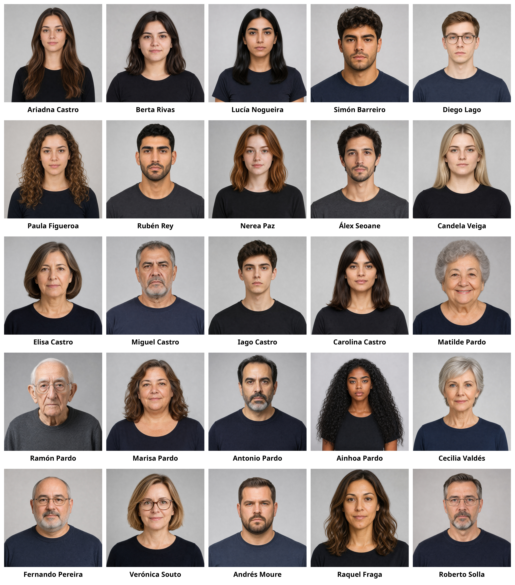
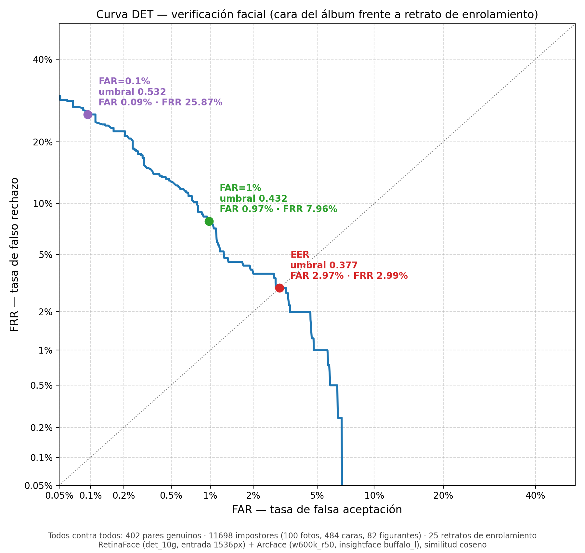
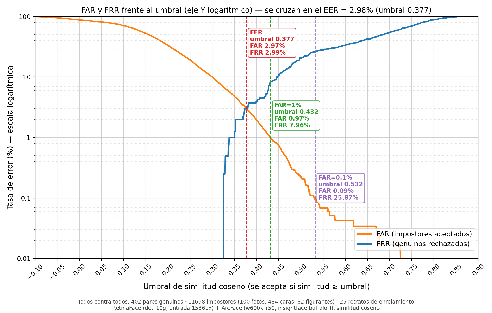

# Trabajo práctico 2  
  
En este trabajo vamos a utilizar un agente para construir un buscador de fotos. La idea es que, dado un álbum de fotos, se pueda buscar por contenido, personas y metadatos. Por ejemplo:

- *«las fotos de la cena de Navidad con mi familia»*
- *«todas las fotos en las que salgo con Simón»*
- *«fotos de pósteres en congresos de 2025»*
- *«fotos sin nadie, solo del sitio»*

La tarea es construir ese buscador con interfaz web, combinando tres fuentes de información:

1. **El contenido de la imagen**: búsqueda por texto libre con **CLIP**.
2. **Las personas que aparecen**: **detección de caras** y **reconocimiento facial** de los 25 personajes del álbum.
3. **Los metadatos** de cada foto (**EXIF**): fecha y hora, cámara, orientación y, en algunas, coordenadas GPS.

Todas las personas y fotos son **sintéticas**: las ha generado una IA y no corresponden a nadie real.

## Contenido del repositorio

| Ruta | Contenido |
|---|---|
| `img/fotos/` |  Un álbum con 100 fotos de muestra (JPEG). Los nombres son aleatorios y **no** dan pistas del contenido. |
| `img/identidades/` | Una imagen de enrolamiento (retrato) por cada uno de los 25 personajes: `nombre_apellido.jpg`. |
| `img/identidades_todos.jpg` | Mosaico con los 25 personajes y su nombre. |
| `notebooks/` | Tres cuadernos de ejemplo, listos para Google Colab. |

Cada foto puede tener desde ninguna persona hasta seis personajes, además de figurantes anónimos en el fondo que no son ninguno de los 25. Algunas fotos se hicieron con un teléfono móvil y otras con una cámara; solo una parte lleva GPS.

## Cuadernos de partida

| Cuaderno | Descripción | Abrir |
|---|---|---|
| `ejemplo1_openclip.ipynb` | Ejemplo de cómo calcular embeddings de textos e imágenes con OpenCLIP, normalizarlos y obtener la matriz de similitud. |  |
| `ejemplo2_retinaface.ipynb` | Cómo detectar caras con RetinaFace y obtener sus cajas (bounding boxes) `(x1, y1, x2, y2)`. |  |
| `ejemplo3_biometria.ipynb` | Comparar una cara con una imagen de enrolamiento usando ArcFace: score de una pareja *target* y de una *non target*. |  |

Cada cuaderno instala lo que necesita y clona este repositorio, así que debería funcionar en Colab.

## Trabajo a realizar

### 1. Búsqueda por contenido con CLIP (6.0 puntos)

- Calculad el embedding CLIP de las 100 fotos una sola vez y guardadlo. Lo más recomendado es usar una base de datos vectorial como qdrant. Esta tarea se puede realizar en Colab, para acelerar el proceso ya que se puede usar una GPU.
- Diseñad una web dinámica que reciba una consulta de texto y devuelva las n fotos más similares. PAra ello tendrá que calcular el embedding del texto de la consulta y buscar en la base de datos vectorial. 
- Probad varias consultas y comentad cuándo funciona bien y cuándo falla. Algunas ideas para explorar:
  - El modelo de ejemplo está entrenado con textos en inglés: ¿qué pasa si preguntáis en español? ¿Hay modelos multilingües?
  - ¿Cuántos resultados devolver? ¿Un número fijo o un umbral de similitud?
  - ¿Ayuda describir la foto/consulta de varias formas (prompt ensembling) para tener más variedad?
  - Probad otros extractores de embeddings de imágenes y de texto, por ejemplo SigLIP 2 o el original CLIP de OpenAI. ¿Mejoran los resultados?

### 2. ¿Dónde hay personas en cada foto? (1.0 puntos)

- Detectad todas las caras de cada foto con RetinaFace y almacenad sus cajas (bounding boxes) `(x1, y1, x2, y2)` en una tabla (por ejemplo un fichero .csv). Esto se puede hacer en Colab, para acelerar el proceso ya que se puede usar una GPU.
- Visualizad en la aplicación web para una foto cualquiera las cajas de las caras detectadas. Esto os ayudará a entender los errores del detector y a decidir el tamaño de la imagen que le dais al detector (`det_size`). Puede ser una web de prueba aislada de la anterior donde se pueda abrir con un menú de diálogo y seleccionar la foto a visualizar o con un recuadro con drag-and-drop para abrir la foto. La idea es que se pueda ver la foto y las cajas de las caras detectadas sobre ella.
- Cuidado con el tamaño del detector (`det_size`): con valores pequeños se pierden las caras pequeñas de las fotos de grupo.

### 3. ¿Quién sale en cada foto? (2.0 puntos)

  
  

- Elegid el umbral de decisión. Para ello se dan unas curvas medidas sobre este álbum (DET y FAR/FRR frente al umbral) para que escojáis vuestro punto de trabajo y lo justifiquéis por ejemplo 1% de FAR: ¿qué es peor en un álbum de fotos, que falte una foto de Ariadna o que aparezca alguien que no es ella?  

- Calculad el embedding ArcFace de cada cara que aparezca en cada foto con la lista anterior y de las 25 imágenes de enrolamiento. Lo ideal es guardar los embeddings de las caras detectadas en cada foto para no tener que recalcularlos en cada consulta en una base de datos vectorial como qdrant. Este proceso se puede realizar en Colab, para acelerar el proceso ya que se puede usar una GPU.

- Con los embeddings de las caras detectadas y los embeddings de las imágenes de enrolamiento, decidid qué caras corresponden a qué personajes, es decir para cada cara cuál es el vector más cercano de los personajes y con el score decidid si es target o no en función del umbral (Podría ser un personaje anónimo). Guardad el resultado en una tabla.
 

### 4. Metadatos EXIF (0.25 puntos)

- Leed de cada JPEG la fecha y hora, la cámara, la orientación y, si existe, el GPS.
- Convertid las coordenadas en algo útil para buscar (por ejemplo, la ciudad más cercana).

### 5. Búsquedas avanzadas (0.75 puntos)

Las bases de datos como qdrant permiten combinar varios tipos de consulta vectorial y por campos. Disponemos de tres fuentes para responder consultas compuestas, por ejemplo:

- *«Ariadna y Simón cenando»* → personas + CLIP
- *«congresos de 2026 con la cámara Sony»* → CLIP + fecha + cámara
- *«fotos de Ariadna en Vigo»* → personas + GPS

La interfaz es libre: un cuaderno con funciones, una pequeña aplicación… **[PENDIENTE: ¿se pide alguna interfaz concreta?]**

### 6. Evaluación

**[PENDIENTE: decidir cómo se evalúa]** Opciones:

- Entregar, para una lista de consultas que publicaremos, las fotos que devuelve vuestro sistema; nosotros tenemos las etiquetas reales y calcularemos precisión y *recall*.
- Entregar, para cada foto, la lista de personajes detectados, y medir la tasa de acierto de la identificación.

## Qué hay que entregar

**[PENDIENTE]**

- Cuaderno(s) con el código ejecutado.
- Memoria breve: decisiones tomadas (modelos, umbrales, cómo se combinan las búsquedas), ejemplos de consultas que funcionan y que fallan, y análisis de errores.
- Fecha de entrega y forma de entrega.

## Consejos

- Calculad los embeddings una vez y guardadlos (por ejemplo con `numpy.save`). Recalcularlos en cada consulta es lento.
- En Colab, activad la GPU si podéis (*Entorno de ejecución → Cambiar tipo de entorno*). Con 100 fotos también funciona en CPU.
- Mirad las fotos: muchos errores se entienden al verlos (caras de perfil, gafas, caras pequeñas al fondo…).
